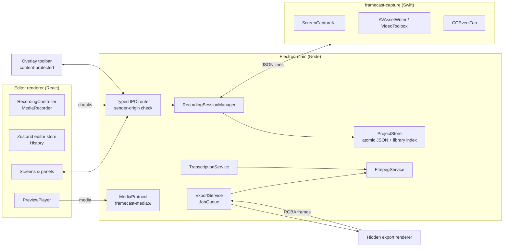
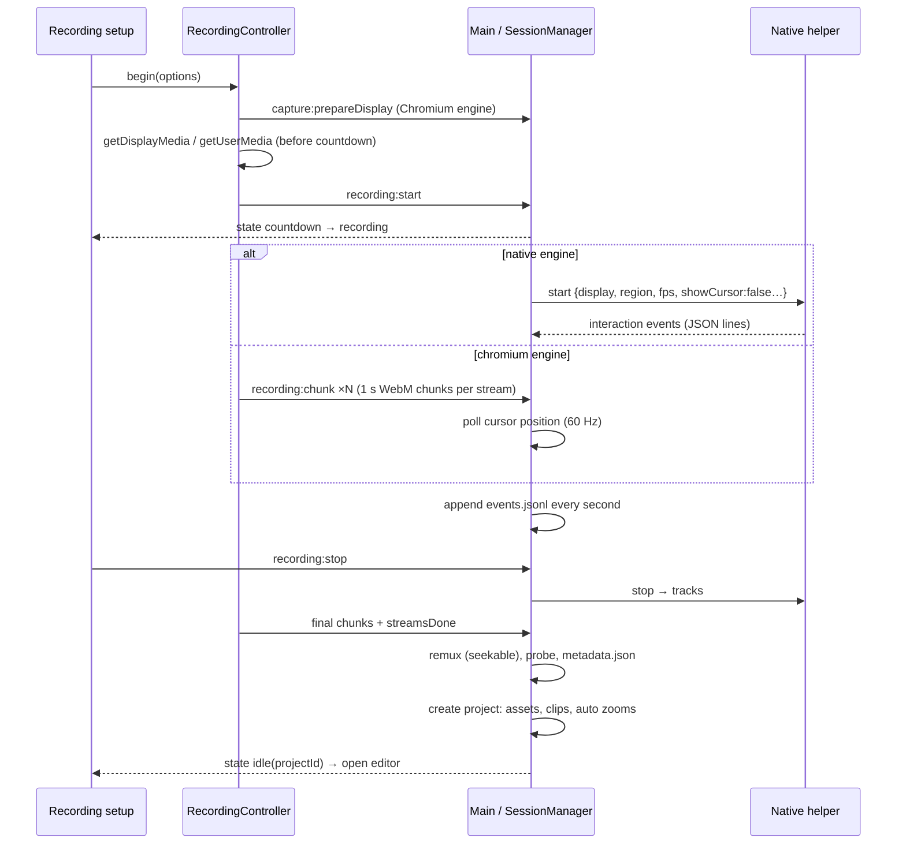

# Architecture

## Principles

1. **Engines are pure.** Everything that decides *what a frame looks like*, including zoom, cursor, animation, captions and layout, lives in `packages/*` as deterministic TypeScript with no I/O. It is unit-tested in Node and reused unchanged by preview and export.
2. **One composition model.** `composeFrame(composition, t)` returns a plain `FrameScene`. The preview player and the exporter both call it and both draw with the same `renderScene()`, so what you see is what you export.
3. **Non-destructive.** Original recordings are never modified. Edits are data in a versioned JSON manifest; auto-generated zooms are ordinary items flagged `origin: 'auto'`.
4. **Local-first and crash-safe.** Media streams to disk while recording, interaction events are flushed every second, and project writes are atomic (temp file → fsync → rename, plus a `.bak`).
5. **Least privilege.** Renderers are sandboxed with context isolation. IPC is an allow-listed, typed contract. Main validates inputs with zod and serves media only from registered roots.

## Process model

| Component (brief §16) | Implementation |
| --- | --- |
| Desktop shell | `apps/desktop/src/main/index.ts`, `windows/*`, `menu.ts` |
| Screen capture service | `native/macos/FramecastCapture` (ScreenCaptureKit) or the Chromium fallback (`renderer/recording/chromium-recorder.ts`) |
| Cursor event tracking | Native `InputTracker.swift` (CGEventTap) or `capture/cursor-tracker.ts` (polling, movement only) |
| Recording session manager | `services/recording/session-manager.ts` (state machine, crash recovery) |
| Media asset manager | `services/projects.ts` (`importMedia`, probing), `services/media-protocol.ts` |
| Project persistence | `services/projects.ts`, `packages/schema` (validation and migrations) |
| Timeline editing engine | `packages/timeline` |
| Animation and keyframe engine | `packages/animation` |
| Subtitle and transcription engine | `packages/subtitles`, `services/transcription.ts` |
| Video composition engine | `packages/compositor` |
| Audio processing engine | Preview: media elements via `PreviewPlayer`. Export: ffmpeg filter graph from `packages/export/audio.ts` |
| Export and rendering engine | `services/export-service.ts`, `renderer/export/export-renderer.ts`, `packages/export` |
| Settings | `services/settings.ts`, `schema/settings.ts` |
| Future cloud services | Not implemented; transcription and export are behind service interfaces |

## Recording flow

A session lives in `<Library>/.sessions/<id>/` until it's finalised. It is then moved (same-volume rename) into `<Project>.framecast/recordings/<id>/`. Sessions with no `finalized` marker are offered for recovery on the next launch.

## Media pipeline

**Preview.** `PreviewPlayer` runs a `requestAnimationFrame` clock. For each frame it calls `composeFrame`, keeps hidden `<video>`/`<audio>` elements within 150 ms of the scene's source times (seeking only on drift), and paints with `renderScene` at device-pixel resolution, capped at 1920 px wide.

**Export.**

1. `ExportService` (main) spawns ffmpeg with `-f rawvideo -pix_fmt rgba -i pipe:0` and any audio inputs.
2. It opens a hidden renderer window, which, for each output frame:
   - evaluates the scene,
   - seeks every needed element *exactly* (awaiting `seeked`),
   - renders to an `OffscreenCanvas` at output resolution,
   - sends the RGBA bytes over IPC.
3. Each frame IPC resolves only after ffmpeg's stdin accepted it, giving natural backpressure.
4. Audio is mixed by an ffmpeg filter graph: `atrim`, `atempo` chains, `volume`, `afade`, `adelay`, `amix`, optional `afftdn`, `sidechaincompress` ducking and `loudnorm`.

Encoders: `h264_videotoolbox` / `hevc_videotoolbox` / `prores_videotoolbox` on macOS with hardware acceleration, otherwise `libx264` / `libx265` / `prores_ks` / `libvpx-vp9`. Transparent exports use ProRes 4444 or VP9 alpha. GIF uses a two-pass palette.

This exporter favours correctness and format breadth over speed; see [Decisions](DECISIONS.md#export-pipeline) for the planned WebCodecs/VideoToolbox fast path.

## Security

- `contextIsolation`, `sandbox`, no `nodeIntegration`, strict CSP. Navigation and `window.open` are blocked.
- The preload exposes only `invoke(channel)` and `on(channel)` for allow-listed channels (`INVOKE_CHANNELS`).
- Every handler checks the sender frame's origin. Errors return messages only, never stacks.
- `project:save` re-validates the whole document with zod. Renderers never send file paths except ones the user chose in native dialogs.
- `framecast-media://` serves only files under the library, open project directories or explicitly imported files.
- Permissions: only `media`/`display-capture` are granted, and only to our origin. macOS TCC status is surfaced in Recording Setup.
- Privacy: keyboard tracking records modifier shortcuts only. Cursor and shortcut tracking are opt-out. Apps can be excluded from capture. Temporary transcription audio is deleted after use.
